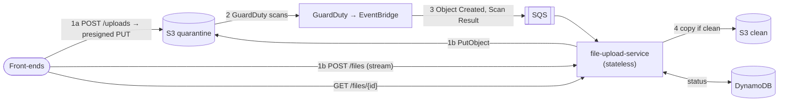

# file-upload-service

Accepts image and PDF uploads from front-end applications, has AWS GuardDuty scan each one for
malware, and moves files that pass to a clean bucket. Front-ends upload in either of two styles:
a presigned S3 URL, or streaming through the service ([comparison](docs/upload-styles.md)). They
follow each file by its status, which records when GuardDuty picked it up, when it finished and
what it found. The service is stateless and never writes files: bytes go straight to S3, and state
lives in DynamoDB.

## Features

What the service does, one row per feature, with the setting that controls it and the section that
explains it. Keep it current: add a row in the same pull request as the feature.

| Feature | What it does | Details |
|---|---|---|
| **Service** | | |
| Presigned upload | `POST /api/v1/uploads` returns an S3 URL signed for the declared type, the exact size and one write; the browser PUTs the file straight to S3 | [Upload styles](docs/upload-styles.md), [REST API](#rest-api) |
| Streamed upload | `POST /api/v1/files` takes the file as the body and streams it to S3 as it arrives: no disk, no buffering, at most `uploads.max-concurrent-streams` at once | [Upload styles](docs/upload-styles.md), [REST API](#rest-api) |
| Accepted files | JPEG, PNG, GIF, WebP, HEIC, TIFF and PDF up to 25 MB (`uploads.allowed-types`, `uploads.max-size`); the declared type and the content's signature must agree | [File lifecycle](#file-lifecycle) |
| Malware scanning | GuardDuty Malware Protection for S3 scans every upload in the quarantine bucket; results arrive through EventBridge and SQS | [File lifecycle](#file-lifecycle), [AWS resources](docs/deployment.md#aws-resources) |
| Promotion | Clean files are copied inside S3 to the clean bucket (only the version scanned) and removed from quarantine; infected and unscanned files are never served | [File lifecycle](#file-lifecycle) |
| Scan tracking | Each file's status with when it landed (GuardDuty picked it up), when the scan finished and the result; scans in progress across all instances (`GET /api/v1/scans`, gauge `scan.in-progress`); overdue scans reported once | [REST API](#rest-api), [Metrics](#metrics) |
| Download | `GET /api/v1/files/{id}/content` redirects to a 5-minute S3 link for an available file | [REST API](#rest-api) |
| API documentation | OpenAPI description at `/v3/api-docs` and Swagger UI at `/swagger-ui.html`, generated from the code; off in production (`FILE_UPLOAD_SERVICE_API_DOCS`) | [API documentation](#api-documentation) |
| Local GuardDuty simulator | On a laptop, invents scan results (the EICAR test string is "infected") so the whole flow runs without AWS; refused in production | [Running locally](#running-locally) |
| **Configuration and security** | | |
| Parameter Store and Vault | Settings from AWS SSM Parameter Store and secrets from HashiCorp Vault, read at startup; the instance refuses to start if either can't be read | [Configuration and secrets](#configuration-and-secrets) |
| Restart check | Every 5 minutes, and on demand (`POST /actuator/configcheck`), checks that the stored configuration would let the instance start again | [Checking the stored configuration](#checking-the-stored-configuration) |
| Production mode | `{E}_MODE=production` refuses to start with settings that are unsafe in production | [Production mode](#production-mode) |
| Secrets in git | SOPS-encrypted files under `config/secrets/`; a pre-commit hook and a CI workflow reject plaintext secrets | [Secrets in git (SOPS)](#secrets-in-git-sops) |
| Outbound proxy | Every connection to an external host through `{E}_PROXY_HOST` when it's set, failing closed | [Outbound proxy](#outbound-proxy) |
| **Operations** | | |
| Coded logs and runbook | Every operational log line has a stable code (`{E}-nnnn`) with a procedure in the runbook; ECS JSON logs; a request id on every response | [Logging and support](#logging-and-support) |
| Metrics and health | Micrometer meters (tagged `mode`), health per dependency, liveness and readiness probes | [Metrics](#metrics) |
| Capacity | Measured cost per unit of work and a rule for how many instances and cores a load needs | [Capacity](#capacity) |
| AWS deployment | EKS behind an ALB, timeouts aligned to the web server, graceful shutdown | [`docs/deployment.md`](docs/deployment.md) |
| **Engineering** | | |
| Design standards | Object granularity, one purpose per method, code the JIT and GC handle well | [Design](#design) |
| Releases | Conventional Commits checked by a hook and in CI; semantic-release publishes each release from `main` | [Contributing](#contributing) |



**Stack:** Java 25 · Spring Boot 4.1.2 · Gradle (wrapper) · Lombok · Micrometer · AWS SDK 2 (S3, SQS, DynamoDB)

## Running locally

### Prerequisites

| Requirement | Why | Notes |
|---|---|---|
| **JDK 17+** | Runs Gradle | The build compiles with a **JDK 25 toolchain**, which Gradle downloads automatically if it isn't installed. |
| **Docker** with Compose v2 | Runs the AWS emulators | S3Mock (S3), ElasticMQ (SQS), DynamoDB Local; all free, no account needed. |
| **Free ports** 8080, 9099, 9324, 8000 | The app; S3, SQS, DynamoDB | If 8080 is taken, `run` and `docker` ask for another (or set `SERVER_PORT`). |
| `curl`, `bash` | Helper script | Preinstalled on macOS and most Linux distributions. |
| `sops`, `age` | Secrets in git, only if `config/secrets/local.enc.env` exists | `brew install sops age`; see [Secrets in git (SOPS)](#secrets-in-git-sops). |

### Quick start

```bash
scripts/dev.sh hooks     # once per clone: check commit messages and plaintext secrets before each commit
scripts/dev.sh check     # verify the prerequisites above
scripts/dev.sh run       # start dependencies, then the app (Ctrl-C to stop)
scripts/dev.sh docker    # or: the same, with the app in Docker as it runs in production
scripts/dev.sh status    # in another terminal

scripts/try-upload.sh presigned photo.jpg   # upload in either style and follow the scan
scripts/try-upload.sh stream report.pdf
```

`run` points the app at the emulators and turns on the **GuardDuty simulator**: no emulator offers
GuardDuty or EventBridge, so the service watches the quarantine bucket and sends itself the events
AWS would, after 3 s (`FILE_UPLOAD_SERVICE_SCAN_SIMULATOR_DELAY`). A file containing the
[EICAR test string](https://www.eicar.org/download-anti-malware-testfile/) comes back infected:
append it to an image to try that path.

### `scripts/dev.sh`

| Command | What it does |
|---|---|
| `check` | Checks Java, Docker, free ports, the outbound proxy and external hosts |
| `infra` | Starts `docker-compose.yml` dependencies and waits until they're healthy |
| `run [args…]` | `check` + `infra`, then `./gradlew bootRun`; extra args go to Spring Boot |
| `docker [args…]` | `check` + `infra`, then builds the image (`bootBuildImage`, as production does) and runs it from `docker-compose.yml`'s `app` service, with a read-only filesystem and an in-memory `/tmp` as on Kubernetes; extra args go to Spring Boot |
| `status` | Shows dependency and app health |
| `test` | Runs the test suite |
| `stop` | Stops the app's container (from `docker`) and the dependencies; data is kept |
| `reset [--yes]` | Removes dependency containers **and their data** (asks first) |
| `hooks` | Installs the git hooks: commit messages, plaintext secrets |

**The app's port** is `SERVER_PORT`, 8080 by default. If it's taken, `run` and `docker` say what
holds it and ask for another (Enter takes the next one). They remember the choice in
`build/dev-port`, where `status` and `scripts/try-upload.sh` find it. Without a terminal to ask,
they stop and ask for `SERVER_PORT` instead.

**In Docker** the app reaches the emulators by their service names (`http://s3:9090`), but presigned
URLs go to programs on your machine, so they carry `http://localhost:9099`
(`FILE_UPLOAD_SERVICE_S3_PRESIGN_ENDPOINT`). The first image build downloads the buildpacks and takes
a few minutes; later ones take under a minute.

### Without the script

```bash
./gradlew bootRun
./gradlew test
./gradlew bootJar && java -jar build/libs/file-upload-service-0.0.1-SNAPSHOT.jar
```

### Troubleshooting

- **`port 8080 is in use`**: another copy may be running (for example from your IDE, or the
  `docker` container: `scripts/dev.sh stop`). `run` and `docker` offer another port.
- **Files stay `AWAITING_UPLOAD`**: the app runs without a queue (log [1011](docs/runbook.md#file_upload_service-1011)); start
  it with `scripts/dev.sh run`, which sets one.
- **`could not create the DynamoDB table`**: DynamoDB Local isn't up; `docker compose ps`.
- The emulators don't check signatures, so a presigned PUT with wrong headers succeeds locally
  where S3 would answer 403. `FileStorageTests` checks what is signed.

## REST API

| Method | Path | Description |
|---|---|---|
| POST | `/api/v1/uploads` | **Presigned style.** Body `{"fileName", "contentType", "size"}`. 201 with `Location` and `{file, upload: {method: "PUT", url, headers, expiresAt}}`: PUT the file to `url` with exactly `headers` before `expiresAt` |
| POST | `/api/v1/files?fileName=…` | **Stream style.** The body is the file (not multipart), `Content-Type` its media type, `Content-Length` its size. 202 with `Location` and the file (`SCANNING`) |
| GET | `/api/v1/files/{id}` | The file: `status`, `createdAt`, `submittedForScanAt` (landed; GuardDuty picked it up), `scanCompletedAt`, `scanResult`, `availableAt`, `rejectedBecause`, `contentUrl` |
| GET | `/api/v1/files/{id}/content` | 303 to a 5-minute download link; 409 unless `AVAILABLE` |
| GET | `/api/v1/scans` | `{inProgress, oldestSubmittedAt, overdueAfter}`: files GuardDuty is scanning now, across all instances |
| GET | `/v3/api-docs`, `/swagger-ui.html` | The OpenAPI description and Swagger UI ([API documentation](#api-documentation)); not in production |
| GET | `/actuator/health` | Health, including `s3`, `dynamoDb` and `scanQueue` (not part of readiness) |
| GET | `/actuator/metrics` | Micrometer meters |

| Status | Meaning |
|---|---|
| 400 | Invalid request, or the body ended before `Content-Length` (`reason`: `INVALID`, `INCOMPLETE`) |
| 404 | No such file (also for ids the service couldn't have issued) |
| 409 | The file isn't available for download |
| 411 | Streamed without `Content-Length` |
| 413 | Larger than `uploads.max-size` (`TOO_LARGE`) |
| 415 | Type not accepted (`UNSUPPORTED_TYPE`), or the content isn't the declared type (`CONTENT_MISMATCH`) |
| 503 | S3 or DynamoDB unavailable (`Retry-After: 5`), or this instance is streaming its maximum (`Retry-After: 1`) |

### API documentation

[springdoc-openapi](https://springdoc.org) generates an OpenAPI 3.1 description of the `/api/**`
endpoints from the controllers and their `@Operation` annotations:

- `http://localhost:8080/v3/api-docs` (JSON; `/v3/api-docs.yaml` for YAML), for generating clients
- `http://localhost:8080/swagger-ui.html`, to read the API and try it ("Try it out" works for
  both upload styles; for the presigned style, the PUT to S3 is a second step outside Swagger UI)

Both are on by default and **refused in production mode** (`FILE_UPLOAD_SERVICE_API_DOCS=false`,
set in `deploy/k8s/configmap.yaml`); the ingress only routes `/api/` anyway. Keep the annotations
current when an endpoint changes: `ApiDocumentationTests` checks the essentials.

**Not built yet:** authentication. Every endpoint is open, and any caller can read any file's
status. Add it (for example JWT bearer tokens, with each file owned by the caller) before exposing
the service.

Errors are returned as RFC 9457 problem details. Every response has an `X-Request-Id` header (the
caller's, if it sent a safe one, otherwise generated), and error bodies repeat it as `requestId`,
so a caller can quote it to support.

## Configuration

| Property | Env | Default |
|---|---|---|
| `file-upload-service.mode` | `FILE_UPLOAD_SERVICE_MODE` | `development`; `production` refuses unsafe settings ([Production mode](#production-mode)) |
| `file-upload-service.ssm.path` / `.region` / `.endpoint` | `FILE_UPLOAD_SERVICE_SSM_PATH` / `FILE_UPLOAD_SERVICE_SSM_REGION` / `FILE_UPLOAD_SERVICE_SSM_ENDPOINT` | blank = off; see [Configuration and secrets](#configuration-and-secrets) |
| `file-upload-service.vault.*` | `FILE_UPLOAD_SERVICE_VAULT_*` | blank address = off; see [HashiCorp Vault](#hashicorp-vault) |
| `file-upload-service.config-check.interval` | `FILE_UPLOAD_SERVICE_CONFIG_CHECK_INTERVAL` | `5m` between [checks of the stored configuration](#checking-the-stored-configuration) |
| `server.tomcat.keep-alive-timeout` | `FILE_UPLOAD_SERVICE_SERVER_KEEP_ALIVE_TIMEOUT` | `130s`; longer than the load balancer's idle timeout ([Timeouts](docs/deployment.md#timeouts)) |
| `file-upload-service.outbound-proxy.type` | `FILE_UPLOAD_SERVICE_PROXY_TYPE` | `HTTP` (or `SOCKS`) |
| `file-upload-service.outbound-proxy.host` | `FILE_UPLOAD_SERVICE_PROXY_HOST` | blank (connect directly) |
| `file-upload-service.outbound-proxy.port` | `FILE_UPLOAD_SERVICE_PROXY_PORT` | `8888` |
| `file-upload-service.storage.quarantine-bucket` / `.quarantine-prefix` | `FILE_UPLOAD_SERVICE_QUARANTINE_BUCKET` / `_PREFIX` | `file-upload-quarantine` / `uploads/`: where uploads land and GuardDuty scans |
| `file-upload-service.storage.clean-bucket` / `.clean-prefix` | `FILE_UPLOAD_SERVICE_CLEAN_BUCKET` / `_PREFIX` | `file-upload-clean` / `files/`: where clean files go; may be the same bucket with a separate prefix |
| `file-upload-service.storage.table` | `FILE_UPLOAD_SERVICE_TABLE` | `file-upload-service-files` |
| `file-upload-service.uploads.max-size` | `FILE_UPLOAD_SERVICE_MAX_SIZE` | `25MB` (at most 5GB) |
| `file-upload-service.uploads.allowed-types` | `FILE_UPLOAD_SERVICE_ALLOWED_TYPES` | `JPEG,PNG,GIF,WEBP,HEIC,TIFF,PDF` |
| `file-upload-service.uploads.url-ttl` | `FILE_UPLOAD_SERVICE_URL_TTL` | `15m`: how long a presigned upload URL works |
| `file-upload-service.uploads.max-concurrent-streams` | `FILE_UPLOAD_SERVICE_MAX_CONCURRENT_STREAMS` | `64` per instance; more get 503 |
| `file-upload-service.uploads.stream-timeout` | `FILE_UPLOAD_SERVICE_STREAM_TIMEOUT` | `5m` to stream one file to S3 |
| `file-upload-service.scan.queue-url` | `FILE_UPLOAD_SERVICE_SCAN_QUEUE_URL` | blank = no scanning (refused in production) |
| `file-upload-service.scan.consumers` | `FILE_UPLOAD_SERVICE_SCAN_CONSUMERS` | `2` receiving threads per instance |
| `file-upload-service.scan.overdue-after` | `FILE_UPLOAD_SERVICE_SCAN_OVERDUE_AFTER` | `5m`, then the scan is reported ([2009](docs/runbook.md#file_upload_service-2009)) |
| `file-upload-service.scan.monitor-interval` | `FILE_UPLOAD_SERVICE_SCAN_MONITOR_INTERVAL` | `15s` between counts of scans in progress |
| `file-upload-service.scan.simulator.enabled` / `.delay` | `FILE_UPLOAD_SERVICE_SCAN_SIMULATOR` / `_DELAY` | `false` / `3s`; local only, refused in production |
| `file-upload-service.aws.region` | `FILE_UPLOAD_SERVICE_AWS_REGION` | blank = the SDK's chain (`AWS_REGION`) |
| `file-upload-service.aws.s3-endpoint` / `.sqs-endpoint` / `.dynamodb-endpoint` | `FILE_UPLOAD_SERVICE_S3_ENDPOINT` / `_SQS_ENDPOINT` / `_DYNAMODB_ENDPOINT` | blank = AWS; emulators only (refused in production) |
| `file-upload-service.aws.s3-presign-endpoint` | `FILE_UPLOAD_SERVICE_S3_PRESIGN_ENDPOINT` | blank = `s3-endpoint`; the S3 address in presigned URLs when browsers reach the emulator by another name (the app in Docker); refused in production |
| `file-upload-service.aws.timeout` | `FILE_UPLOAD_SERVICE_AWS_TIMEOUT` | `10s` per AWS call (a streamed PUT has `stream-timeout`) |
| `spring.servlet.multipart.enabled` | | `false`: multipart parsing would spool to disk |
| `springdoc.api-docs.enabled`, `springdoc.swagger-ui.enabled` | `FILE_UPLOAD_SERVICE_API_DOCS` | `true`; must be `false` in production ([API documentation](#api-documentation)) |
| `logging.structured.format.console` | `FILE_UPLOAD_SERVICE_LOG_FORMAT` | blank = readable text; `ecs` for ECS JSON in production |
| `logging.structured.ecs.service.environment` | `FILE_UPLOAD_SERVICE_ENVIRONMENT` | `local` |

### Outbound proxy

When `FILE_UPLOAD_SERVICE_PROXY_HOST` is set, every connection to an external host goes through that proxy
(HTTP `CONNECT`, e.g. tinyproxy, or SOCKS5). It fails closed: the service refuses to start rather
than connect directly.

The service calls no external hosts. S3, SQS and DynamoDB, like Parameter Store, are AWS services
reached through VPC endpoints on the private network, not through the proxy. Presigned URLs point
browsers at S3's public endpoint, which is the browser's traffic, not the service's.

| Destination | Port |
|---|---|
| none | |

## Configuration and secrets

Settings come from four places, and a later one overrides an earlier one:

| Order | Source | Holds | Set up with |
|---|---|---|---|
| 1 | `application.yml` | defaults, for local development | in the repository |
| 2 | **AWS SSM Parameter Store** | an environment's non-secret settings | `FILE_UPLOAD_SERVICE_SSM_PATH=/file-upload-service/prod/` |
| 3 | **HashiCorp Vault** | the environment's secrets | `FILE_UPLOAD_SERVICE_VAULT_ADDRESS`, `FILE_UPLOAD_SERVICE_VAULT_AUTH`, … |
| 4 | environment variables, then command-line arguments | overrides, e.g. during an incident | as usual |

Parameter Store and Vault are read **once at startup**, before anything else runs; a change takes
effect at the next start (a rolling restart). Both are off until configured, so local runs need
neither. Once configured, they **fail closed**: if one can't be read, the instance refuses to start
([FILE_UPLOAD_SERVICE-1004](docs/runbook.md#file_upload_service-1004)) rather than run on defaults or without
its secrets. The startup log names each path and the number of keys loaded, never the values. Both
are reached **directly** (Parameter Store through a VPC endpoint, Vault on the private network),
not through the outbound proxy.

### AWS SSM Parameter Store

Each parameter under the path is one property: `/file-upload-service/prod/file-upload-service/outbound-proxy/host`
(or `/file-upload-service/prod/file-upload-service.outbound-proxy.host`) sets `file-upload-service.outbound-proxy.host`. Credentials
and region come from the AWS SDK's default chain (IRSA on EKS, the task role on ECS). The role
needs `ssm:GetParametersByPath` on the path, and `kms:Decrypt` for SecureString parameters.

### HashiCorp Vault

One key/value secret (v2 by default); each key is a property name:
`vault kv put secret/file-upload-service/prod file-upload-service.database.password=…`.

| Setting | Env | Default |
|---|---|---|
| `file-upload-service.vault.address` | `FILE_UPLOAD_SERVICE_VAULT_ADDRESS` | blank = off. https only; http is accepted for localhost |
| `file-upload-service.vault.kv-mount` / `.path` | `FILE_UPLOAD_SERVICE_VAULT_KV_MOUNT` / `FILE_UPLOAD_SERVICE_VAULT_PATH` | `secret` / `file-upload-service` |
| `file-upload-service.vault.auth` | `FILE_UPLOAD_SERVICE_VAULT_AUTH` | `token`, `kubernetes` or `app-role` |
| `file-upload-service.vault.token` | `FILE_UPLOAD_SERVICE_VAULT_TOKEN` | for `auth=token`; an environment variable, never a file in git |
| `file-upload-service.vault.kubernetes.role` | `FILE_UPLOAD_SERVICE_VAULT_KUBERNETES_ROLE` | for `auth=kubernetes`: the pod's service-account token |
| `file-upload-service.vault.app-role.role-id` / `.secret-id-file` | `FILE_UPLOAD_SERVICE_VAULT_APP_ROLE_ID` / `FILE_UPLOAD_SERVICE_VAULT_APP_ROLE_SECRET_ID_FILE` | for `auth=app-role` |
| `file-upload-service.vault.namespace` / `.ca-cert` | `FILE_UPLOAD_SERVICE_VAULT_NAMESPACE` / `FILE_UPLOAD_SERVICE_VAULT_CA_CERT` | blank; a PEM file for a private CA |

Login tokens are revoked straight after the read. Vault policy:
`path "secret/data/file-upload-service/prod" { capabilities = ["read"] }`.

### Secrets in git (SOPS)

Secrets that must live in the repository (for local development or CI) are encrypted with
[SOPS](https://github.com/getsops/sops) and [age](https://github.com/FiloSottile/age), under
`config/secrets/` only:

1. Each developer, and CI, makes an age key pair: `age-keygen -o ~/.config/sops/age/keys.txt`.
2. Their public keys (`age1…`) go in `.sops.yaml`, replacing the placeholder. Re-encrypt after a
   change: `for f in config/secrets/*.enc.*; do sops updatekeys -y "$f"; done`.
3. Create or edit a file with `sops config/secrets/local.enc.env`; SOPS opens it decrypted in your
   editor and writes it back encrypted.
4. `scripts/dev.sh run` decrypts `config/secrets/local.enc.env`, if it exists, into the app's
   environment only; nothing decrypted is written to disk.

`scripts/check-secrets.sh` (the pre-commit hook, installed by `scripts/dev.sh hooks`, and the
`secrets` workflow) rejects unencrypted files under `config/secrets/`, `.env` and key files,
decrypted SOPS files, and private keys, age secret keys, AWS access key ids and Vault tokens in any
file. If a secret was ever committed in plaintext, **rotate it first**: removing it from history
doesn't un-leak it.

### Checking the stored configuration

A change in Parameter Store or Vault, an expired credential or a removed permission doesn't affect
running instances, so it goes unnoticed until the next restart, which then fails. To find out
first, every instance checks every `file-upload-service.config-check.interval` (5 minutes) whether it would
start again: it reads both stores exactly as startup does, puts the fresh values in place of those
it started with, and validates them as startup would (the settings records bind, and production
mode's rules pass).

| Where | Restart would succeed | Restart would fail |
|---|---|---|
| `GET /actuator/configcheck` (latest), `POST` (check now) | `"restartable": true` | `"restartable": false` and `problems` |
| `GET /actuator/health`, component `configCheck` | `UP` | `DOWN` (overall HTTP 503) |
| `file-upload-service.config.restartable` gauge | 1 | 0 |
| Log | [FILE_UPLOAD_SERVICE-1007](docs/runbook.md#file_upload_service-1007) once it recovers | [FILE_UPLOAD_SERVICE-1006](docs/runbook.md#file_upload_service-1006) at every check |

Readiness and liveness are unaffected, so one bad parameter can't take every instance out of
service. Changed keys are listed by name, never value
([FILE_UPLOAD_SERVICE-1008](docs/runbook.md#file_upload_service-1008)). Each check logs in to Vault like a
start does: with AppRole, don't limit the secret ID's number of uses.

### Production mode

`FILE_UPLOAD_SERVICE_MODE=production` (default `development`) says the instance runs in production. It shows in
the startup log, `/actuator/info`, the `configCheck` health details and as a `mode` tag on every
metric. In production mode the instance **refuses to start**
([FILE_UPLOAD_SERVICE-1005](docs/runbook.md#file_upload_service-1005)) without Parameter Store and Vault, or
with text logs instead of `FILE_UPLOAD_SERVICE_LOG_FORMAT=ecs`, and names each setting to change. Add a rule to
`ProductionSafeguards` for every setting whose default is only safe locally.

## Deployment

[`docs/deployment.md`](docs/deployment.md): several instances behind an AWS Application Load
Balancer, on Kubernetes (EKS), with the load balancer settings, the timeouts that
must agree with the web server, graceful shutdown, and ready-made files in [`deploy/k8s/`](deploy/k8s).

## Logging and support

Logs are built for production support and log processors (ELK, Splunk, New Relic):

- **Every operational event has a stable code** (`FILE_UPLOAD_SERVICE-nnnn`) with an SOP in
  [`docs/runbook.md`](docs/runbook.md), which also shows how to search in Kibana, Splunk and
  New Relic.
- **JSON in production** (`FILE_UPLOAD_SERVICE_LOG_FORMAT=ecs`): one Elastic Common Schema object per
  line, with `event.code`, `event.reference` (the SOP link), `http.request.id`,
  `file-upload-service.*` details and `error.*`.
- **One id per request:** `X-Request-Id` ties a caller's error response to every log line it
  caused.

| Code range | Area |
|---|---|
| `FILE_UPLOAD_SERVICE-1xxx` | Lifecycle |
| `FILE_UPLOAD_SERVICE-2xxx` | Requests and business outcomes |
| `FILE_UPLOAD_SERVICE-3xxx` | Dependencies |
| `FILE_UPLOAD_SERVICE-9xxx` | Unexpected failures |

## Metrics

| Meter | Type | Tags |
|---|---|---|
| `http.server.requests` | timer, p50/p95/p99 | `method`, `uri`, `status`, `outcome` |
| `file-upload-service.config.restartable` | gauge | 1 while the stored configuration would let the instance start again, else 0 |
| `file-upload-service.uploads` | counter | `method` (`presigned_url`, `stream`), `outcome` (`accepted`, `rejected`) |
| `file-upload-service.uploads.bytes` | counter | `method`: bytes landed in quarantine |
| `file-upload-service.uploads.streaming` | gauge | streamed uploads in progress on this instance (limit `max-concurrent-streams`) |
| `file-upload-service.scan.in-progress` | gauge | files waiting for GuardDuty's result, **across all instances** (from DynamoDB) |
| `file-upload-service.scan.duration` | timer, p50/p95/p99 | `result`: from landing to GuardDuty's result (GuardDuty's time) |
| `file-upload-service.scan.overdue` | counter | scans with no result after `overdue-after` |
| `file-upload-service.files.time-to-available` | timer, p50/p95/p99 | `method`: from landing to available, what callers wait |
| `file-upload-service.events.wait` | timer, p50/p95/p99 | time an event waited in SQS before the service took it (queue backlog) |
| `file-upload-service.events` | counter | `outcome` (`handled`, `failed`, `unrecognised`, `unknown_file`) |
| `file-upload-service.aws.requests` | timer, p50/p95/p99 | `service`, `operation`, `outcome`: every AWS call with its retries; SQS `ReceiveMessage` includes its long-poll wait |

Every meter is also tagged `mode`. Work that passes through a queue or an asynchronous stage
(messages, streams, scheduled batches) gets two timers: from receipt to where it leaves (what a
caller experiences), and the time it waited inside (which grows when the service falls behind).
Stamp the work with `System.nanoTime()` when it arrives, and add both timers to this table.

## File lifecycle

```mermaid
stateDiagram-v2
    [*] --> AWAITING_UPLOAD: URL issued / stream started
    AWAITING_UPLOAD --> SCANNING: object lands in quarantine (GuardDuty picks it up)
    SCANNING --> PROMOTING: NO_THREATS_FOUND
    SCANNING --> INFECTED: THREATS_FOUND
    SCANNING --> NOT_SCANNED: UNSUPPORTED, ACCESS_DENIED, FAILED
    PROMOTING --> AVAILABLE: content is the declared type; copied to clean
    PROMOTING --> REJECTED: content mismatch, or changed after the scan
    AWAITING_UPLOAD --> [*]: never uploaded: record expires (TTL)
```



- **GuardDuty reports no "scan started" event**, and no count of scans in progress. It scans every
  object when it lands in the protected bucket, so the service takes S3's "Object Created" time as
  the moment GuardDuty picked the file up (`submittedForScanAt`). It counts scans in progress from
  its own records: files that landed and have no result.
- Events arrive at least once and in any order (a result may come before "Object Created"). Every
  change is a conditional write that only moves a file forward, so repeats and reordering are
  harmless.
- Only clean files leave quarantine. The copy is conditional on the ETag GuardDuty scanned, and
  uploads can't overwrite an object (`If-None-Match: *`), so the file served is the file scanned.
- Infected and unscanned files stay in quarantine, are never served, and expire after 30 days
  (bucket lifecycle rule). An unscanned file counts as unsafe.

## Data

DynamoDB table `file-upload-service-files` ([`deploy/aws/dynamodb-table.json`](deploy/aws/dynamodb-table.json)),
one item per file:

| Attribute | Type | Meaning |
|---|---|---|
| `id` | S, key | UUID; the object key is `<prefix><id>` in both buckets |
| `fileName`, `fileType`, `size`, `method` | S, S, N, S | As declared: name without path, `PNG`…, bytes, `PRESIGNED_URL` or `STREAM` |
| `status` | S | [File lifecycle](#file-lifecycle) |
| `createdAt`, `submittedAt`, `scannedAt`, `availableAt` | N | Epoch milliseconds of each step |
| `scanResult`, `reason` | S | GuardDuty's result; the threat, GuardDuty's reasons or the rejection (support only) |
| `scanQueue` | S | `SCANNING` while scanning, else absent: puts the item in the sparse `scanning` index (`scanQueue`, `submittedAt`), which the count and the overdue check read |
| `expiresAt` | N | Epoch seconds; DynamoDB's TTL deletes a record whose upload never came. Removed once it lands |
| `overdueReportedAt` | N | Set by the one instance that reported the scan overdue |

## Layout

```
com.crisinis.fileuploadservice
├── config/       settings records, AWS clients (AwsClients, AwsCallMetrics), ProductionSafeguards,
│                 ApiDocumentation (OpenAPI)
├── configdata/   Parameter Store and Vault at startup; ConfigCheck
├── logging/      LogEvent catalogue, request ids
├── model/        FileRecord, FileType (signatures), FileStatus, ScanResult, UploadMethod
├── service/      UploadService (both styles), ScanOutcomes (events → status, promotion), ScanMonitor
├── storage/      FileStorage: S3 presigning, streaming, promotion
├── persistence/  FileRepository: DynamoDB records and the scanning index
├── events/       SQS consumer, EventBridge event parser, the local GuardDuty simulator
└── web/          FileController, FileView, ApiExceptionHandler, RequestIdFilter
```

## Capacity

How much one instance can carry, measured, and how to size a deployment from it. Fill this in once
the service does real work, and measure again whenever a hot path changes.

**What was measured.** <!-- instance type or machine, JVM heap, data set, which dependencies were real -->

| Load | Requests/s (or events/s) | CPU (cores) | Heap | Egress | Latency p50 / p99 |
|---|---|---|---|---|---|
| none | | | | | |
| <!-- e.g. 50 clients --> | | | | | |

**Sizing rules** (replace the factors with the measured ones):

```
cores          ≈ baseline + cost per 1,000 requests/s × requests/s ÷ 1,000   → vCPUs ≈ 2 × cores
heap           ≈ baseline + per-client or per-request memory                → container ≈ heap + 650 MiB
egress         ≈ bytes per response × requests/s
per instance   = total ÷ (instances − instances in one AZ)                 (enough after losing an AZ)
```

**Measuring:**

```bash
scripts/dev.sh run --file-upload-service.instance=agent
node scripts/load-http.mjs 50 60 http://localhost:8080/api/v1/<resource>   # clients, seconds, URL
curl -s localhost:8080/actuator/metrics/process.cpu.usage
curl -s localhost:8080/actuator/metrics/jvm.memory.used?tag=area:heap
```

Restart between runs (percentiles cover the last two minutes), and run the load generator on
another machine when you can: on the same one it competes for the CPU being measured.

## Design

Why the code is shaped the way it is. The shared rules are in
[`docs/design-principles.md`](docs/design-principles.md). Update this section in the same pull
request as the change.

### Decisions

| Decision | Why | Trade-off |
|---|---|---|
| EKS, not ECS | The team runs EKS: Vault login with the pod's service-account token, `deploy/k8s/` only | A cluster, nodes and add-ons to keep current |
| Both upload styles, one pipeline | The team is choosing ([comparison](docs/upload-styles.md)); everything after the bytes land is shared | Two endpoints to secure and test |
| State only in DynamoDB, S3 and SQS | Stateless instances: any instance answers for any file; restarts lose nothing | A DynamoDB call per status read |
| Raw body for streaming, multipart off | Multipart parsing spools to disk; a raw body streams straight to S3 | Plain HTML forms can't post it; front-ends use `fetch` |
| Content checked by signature, after the scan for presigned | The service never sees presigned bytes; reading 16 bytes from S3 at promotion is cheap | A wrong file is refused only after its scan |
| Events through EventBridge → SQS, not S3 notifications to the service | SQS shares work across instances, retries and dead-letters; EventBridge carries both S3's and GuardDuty's events | Two more resources to deploy |
| "Picked up" = S3's Object Created time | GuardDuty publishes no scan-start event and scans on arrival | Not GuardDuty's own start time |
| Count of scans from a sparse index | Reads only files in flight, not the table | One partition key: about 1,000 status changes a second before it needs sharding |
| Copy inside S3 to promote | No bytes through the service; one request | Single-request copy limits files to 5 GB (`max-size` enforces it) |
| A GuardDuty simulator in the service | No emulator offers GuardDuty or EventBridge; the demo runs end to end on a laptop | Code that must never run in production (refused by production mode) |
| REST only, no gRPC API | Clients upload files over HTTP; one protocol, one port, one ALB target group | Clients that want gRPC call the REST API instead |

### Patterns

| Pattern | Where | Why here |
|---|---|---|
| Repository | `persistence/FileRepository` | One place for DynamoDB access and its conditional writes. |
| Adapter | `storage/FileStorage` | S3 behind domain operations (presign, store, promote); SDK errors become `DependencyUnavailableException`. |
| State machine with conditional transitions | `FileStatus`, `FileRepository` | Idempotent under at-least-once, unordered delivery. |
| Competing consumers | `events/ScanEventConsumer` | SQS shares events across instances; failures are redelivered. |
| Sealed event type | `events/ScanEvent` | The parser reduces AWS's JSON to three cases the switch must cover. |
| Interceptor | `config/AwsCallMetrics` | One timer per AWS operation without wrapping each call. |
| Catalogue and fluent builder | `LogEvent.X.at(log).with(...).log()` | Every operational line has a stable code, level and SOP link. |
| Template method hook | `ApiExceptionHandler.createResponseEntity` | Adds the `requestId` to Spring's own problem responses. |
| Scoped resource | `RequestIds.bind` returns a `Scope` for try-with-resources | The request id can't leak into the next task on a pooled thread. |

**Deliberately not used:** interface-plus-`Impl` pairs for single implementations (tests mock the
AWS SDK's own interfaces); the DynamoDB Enhanced Client (eleven attributes don't need a mapper);
Spring Cloud AWS (a receive loop is 60 lines and keeps shutdown under our control); S3 Transfer
Manager (single PUTs and copies suffice at 25 MB).
<!-- Add others with the reason. -->

### Hot paths

- **Per streamed upload:** the body passes from Tomcat to the SDK through `ExactLengthInputStream`
  (no copy beyond the SDK's buffer); memory per upload is constant, and
  `max-concurrent-streams` bounds the total. A virtual thread waits on the network meanwhile.
- **Per status read:** one consistent DynamoDB `GetItem`.
- **Per event:** one conditional `UpdateItem`; for a clean file, a 16-byte ranged `GetObject`, a
  `CopyObject`, a `DeleteObject` and an `UpdateItem`.
- **Per monitor run (each instance, every 15 s):** a `COUNT` query over the scanning index; cost
  grows with scans in flight, not with the table.
- Meters are registered once (enum maps); no per-event registration.

## Contributing

### Commit messages (semantic-release)

Versions and release notes are generated by semantic-release from the commits on `main`, so
commits follow [Conventional Commits](https://www.conventionalcommits.org/). Every push to `main`
(the squash of a release PR) runs `.github/workflows/release.yml`: it runs the tests, then
semantic-release creates the `vX.Y.Z` tag and a GitHub release with notes: the title of each
change under "Features" (or "Bug Fixes", ...), any "⚠ BREAKING CHANGES", then each change's body
under "Details", without trailers (`Co-Authored-By`, `Signed-off-by`, `Reviewed-by`, `Refs`). The
body is published, so say there what changes and how to upgrade. Nothing is released if the tests
fail, or if no commit since the last tag calls for a release. Release notes live in GitHub
releases, not a changelog file: committing one would mean the release job pushing to `main`.

```
<type>(<scope>)!: <subject>

<body: why, wrapped at 100>

Co-Authored-By: Name <email>
BREAKING-CHANGE: <what breaks and how to migrate>
```

| Type | Release |
|---|---|
| `feat` | minor |
| `fix`, `perf`, `refactor`, `revert` | patch |
| `docs`, `test`, `build`, `ci`, `chore`, `style` | none |
| `!` or a `BREAKING CHANGE:` footer | **major** |

The subject is imperative, starts with a lower-case letter, and has no full stop. Spell the
breaking-change footer `BREAKING-CHANGE:` or `BREAKING CHANGE:` (singular; semantic-release misses
the plural), never start a body line with "breaking change" in prose (semantic-release reads it as
a breaking change in any case), and make it the **last** line of the message: everything after it lands in the release notes. With
trailers, use the hyphenated form as the last trailer, so GitHub still sees the trailers. Write
`#N` only for a real reference; any `#4` becomes "closes #4" in the notes. `.githooks/commit-msg`
(installed with `scripts/dev.sh hooks`) rejects non-compliant messages before they're committed,
and the `commitlint` workflow checks every pull request's commits and title.

### Branching and merging

- Work branches come from `develop` and merge into it with a **merge commit**, never a squash or
  rebase.
- `develop` → `main` is a **squash** merge. The PR title becomes the release commit, so it must
  be a valid Conventional Commit carrying the highest bump in the branch.
- After every merge to `main`, **back-merge `main` into `develop`** with a merge commit, so the
  next release PR has no conflicts.
- `scripts/github-branch-rules.sh` enforces this on GitHub; run it without arguments for a dry run.
  Rulesets need GitHub Pro or Team for a private repository; without them, follow these rules by
  hand and only merge a pull request once its `commitlint` check has passed.
