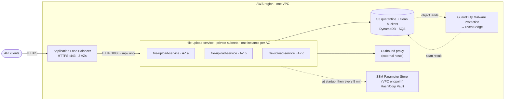
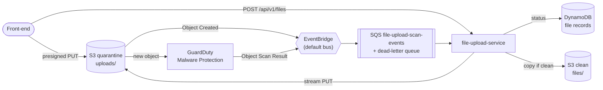
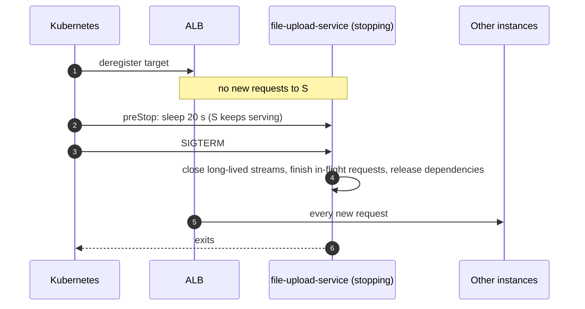

# Deploying file-upload-service

How to run file-upload-service in production on AWS with high availability: several instances behind
an Application Load Balancer (ALB), as pods on [Kubernetes (EKS)](#kubernetes-eks).

The [load balancer settings](#load-balancer) and the [timeouts](#timeouts) must agree with the web
server's settings in `application.yml`. Ready-made Kustomize files are in
[`deploy/k8s/`](../deploy/k8s). Values to replace are marked `CHANGE`.

## The deployment model



- **Three instances, one per availability zone (AZ).** Each is sized to carry the whole load, so
  two can serve everything while the third is replaced. How many cores, how much memory and how
  much network that takes: README "Capacity", from measurements.
- **Any instance serves any request.** Keep state that must survive an instance in a dependency
  (database, cache), never in one instance's memory, and use no sticky sessions.
- **Settings and secrets** are read at startup from SSM Parameter Store and Vault over the private
  network, and re-checked every 5 minutes (README "Checking the stored configuration").
- **Production mode** (`FILE_UPLOAD_SERVICE_MODE=production`, set in `deploy/`) refuses to start with
  settings that are unsafe in production (README "Production mode").
- **Only the ALB is public**, and it routes only `/api/`. `/actuator` (health details, metrics,
  `configcheck`) is reachable only inside the VPC.

## What survives what

| Failure | Effect on clients | Effect on data |
|---|---|---|
| One instance stops (deploy, scale-in) | None: the ALB stops routing to it before it stops ([Stopping an instance](#stopping-an-instance)) | None |
| One instance or AZ fails abruptly | Requests in flight on it fail; the ALB stops routing to it within 30 s | Whatever it held only in memory |
| SSM or Vault is down, or a stored value is bad | None for running instances. Within 5 minutes each reports that a restart would fail ([FILE_UPLOAD_SERVICE-1006](runbook.md#file_upload_service-1006)), without leaving the load balancer | New instances refuse to start ([FILE_UPLOAD_SERVICE-1004](runbook.md#file_upload_service-1004)), so a deploy stalls and rolls back. Check first: `POST /actuator/configcheck` |

| S3 is down or slow | Uploads and downloads fail with 503 (presigned PUTs fail at S3); status reads still work | None: nothing was accepted. Promotions wait in the queue and finish when S3 recovers |
| DynamoDB is down | Every API call fails with 503; presigned PUTs to still-valid URLs succeed | None: their events wait in the queue (retried, then the dead-letter queue) and are redriven |
| SQS or EventBridge is down, or the rules are wrong | Uploads are accepted; files stay `SCANNING` and `scan.in-progress` grows; overdue scans are reported ([2009](runbook.md#file_upload_service-2009)) | None while events are kept: SQS keeps them 4 days. A wrong rule loses events: fix it, then re-run the scans (below) |
| GuardDuty is slow or its plan is unhealthy | Files stay `SCANNING` longer; nothing unscanned is ever served | None |
| All instances restart, or are killed (`kill -9`, OOM) | Streamed uploads in flight fail and are retried by callers; presigned PUTs are unaffected | None: every state is in DynamoDB, S3 and SQS, and interrupted work is finished by redelivery or the recovery job (README "Crash safety") |
| Bedrock is down, throttled or the model is unavailable | Nothing: uploads and scans carry on; extractions wait and retry, then FAILED after `max-attempts` ([3008](runbook.md#file_upload_service-3008), [2015](runbook.md#file_upload_service-2015)) | None; failed extractions can be re-run once fixed |
| An instance dies during a model call | Nothing | None: the lease ends and another instance extracts the file |
| Instances crash repeatedly on some events | Their events reach the dead-letter queue | None: the recovery job finishes interrupted promotions and applies results from GuardDuty's object tags; redriving the dead-letter queue is safe |

**Re-running scans** for files stuck `SCANNING` after lost events: GuardDuty scans an object again
when it's written again, so copy each one onto itself (`aws s3 cp s3://<quarantine>/<key>
s3://<quarantine>/<key> --metadata-directive REPLACE`); the new events finish the flow.

## AWS resources

What the service needs besides its pods. Files to start from are in [`deploy/aws/`](../deploy/aws):
replace the account id `123456789012`, the region and the bucket names.



| Resource | Settings | File |
|---|---|---|
| **Quarantine bucket** `file-upload-quarantine` | Block all public access; SSE-S3 or SSE-KMS (**not** SSE-C, which GuardDuty can't read); **EventBridge notifications on**; CORS for the front-ends' origins (PUT with `content-type`, `if-none-match`); lifecycle: expire `uploads/` after 30 days, so infected and unscanned files are kept for investigation and then removed | `quarantine-cors.json`, `quarantine-lifecycle.json` |
| **Clean bucket** `file-upload-clean` | Block all public access; encrypted; versioning if files must be recoverable. Only the service writes to it. May be the quarantine bucket with prefix `files/`, if the protection plan covers only `uploads/` | |
| **GuardDuty Malware Protection for S3** | A protection plan on the quarantine bucket, limited to prefix `uploads/`; **tagging on**: it adds `GuardDutyMalwareScanStatus` to each object, a second record of the result that [crash recovery](../README.md#crash-safety) reads when the result event is lost; its IAM role as GuardDuty's documentation gives it, plus `kms:Decrypt` on the bucket key with SSE-KMS. A plan protects one bucket; an account may have 25 | |
| **EventBridge rules** on the default bus | `file-upload-object-created` (S3 "Object Created" for `uploads/`) and `file-upload-scan-result` (GuardDuty's "Object Scan Result" for the bucket), both targeting the queue | `eventbridge-object-created.json`, `eventbridge-scan-result.json` |
| **SQS queue** `file-upload-scan-events` | Standard queue; visibility timeout 60 s (above the longest promotion: a copy of `max-size`); retention 4 days; redrive to `file-upload-scan-events-dlq` after 5 receives; a policy letting the two rules send | `scan-queue-policy.json` |
| **DynamoDB table** `file-upload-service-files` | On-demand; the sparse `in-flight` index; **TTL on `expiresAt`** (removes records of uploads never made); point-in-time recovery | `dynamodb-table.json` (`aws dynamodb create-table --cli-input-json file://deploy/aws/dynamodb-table.json`, then `update-time-to-live --time-to-live-specification Enabled=true,AttributeName=expiresAt`) |
| **The service's IAM role** (EKS Pod Identity or IRSA, `serviceaccount.yaml`) | S3 on the two prefixes, the table and its index, receive and delete on the queue; plus SSM as before, and `kms:Decrypt`/`kms:GenerateDataKey` on keys used by the buckets, table or queue | `service-policy.json` |
| **Bedrock model** | The trained model, as a model ARN the service can call with Converse (custom/fine-tuned with provisioned throughput, an imported model, or an inference profile), in the service's region. Set its id in Parameter Store: `file-upload-service/extraction/model-id`. Check its quota (tokens and requests per minute) against `extraction.concurrency` × instances | |
| **VPC endpoints** | Gateway endpoints for S3 and DynamoDB; interface endpoints for SQS, **Bedrock Runtime** (`bedrock-runtime`) and SSM. The service reaches AWS through these, not the outbound proxy | |

**Parameters** in Parameter Store under the service's path (README "Configuration"):
`file-upload-service/scan/queue-url`, and `file-upload-service/storage/quarantine-bucket`,
`clean-bucket` and `table` when the names differ from the defaults.

**`/internal/` stays internal:** the ingress routes only `/api/`; internal systems call the service
inside the cluster (its Service, port 80). Add a NetworkPolicy allowing only those callers on
`/internal/` if other workloads share the cluster: extraction results are personal data.

**Presigned uploads come from browsers**: the URL points at S3's public endpoint, so front-ends
need network access to S3 and the bucket's CORS rules must list their origins. The bucket policy
can additionally deny `s3:PutObject` without `s3:if-none-match` and require TLS
(`aws:SecureTransport`).

## Container images

Spring Boot builds an OCI image with Cloud Native Buildpacks; no Dockerfile is needed:

```bash
./gradlew bootBuildImage --imageName=123456789012.dkr.ecr.ap-southeast-2.amazonaws.com/file-upload-service:1.0.0
```

- **Tag images with the release version** that semantic-release publishes, never `latest`, so a
  deploy names exactly what it runs and a rollback is a tag change.
- **The architecture is the build machine's** (`arm64` on Apple silicon, which suits Graviton).
  Build on the architecture you run, and set the node type to match.
- **The image is minimal:** no shell or `curl`, and it runs as user `1002:1001`. Health checks run
  over HTTP from outside (the ALB, Kubernetes probes), and Kubernetes uses the built-in `sleep`
  action for `preStop`.
- **The heap is sized from the container's memory limit**: about the limit minus 650 MiB (thread
  stacks, code cache, metaspace). Below 1 GiB it's usually too small to start. Measure the heap in
  use under load and size from that.
- **Set `BPL_JAVA_NMT_ENABLED=false`**, or the image prints a native-memory report to stdout at
  exit, breaking the one-JSON-object-per-line logs. The files in `deploy/` set it.

## Load balancer

One internet-facing ALB in the public subnets of three AZs.

- **HTTPS :443** with an ACM certificate and `ELBSecurityPolicy-TLS13-1-2-2021-06`; **HTTP :80**
  only redirects.
- **Rule:** `/api/*` forwards to the target group; the **default action** returns a fixed 404.
- **HTTP/2 to clients** stays on (the default).

| Target group setting | Value | Why |
|---|---|---|
| Target type, protocol, port | `ip`, HTTP, 8080 | EKS pods are addressed directly; TLS ends at the ALB |
| Protocol version | `HTTP1` (default) | Tomcat speaks HTTP/1.1; WebSocket upgrades need it |
| Algorithm | `least_outstanding_requests` | Spreads slow and long-lived requests better than round robin. The ALB has no least-connections mode |
| Stickiness, slow start | off | Any instance serves any request; slow start isn't supported with least outstanding requests |
| Deregistration delay | 30 s | See [Timeouts](#timeouts) |
| Health check | `/actuator/health/readiness`, every 10 s, timeout 5 s, healthy 2, unhealthy 3, code 200 | In service 20 s after it's ready; out 30 s after it fails |

Readiness deliberately leaves out dependencies and the configuration check: if one fails, every
instance would turn unhealthy at once. Alert on them separately (`GET /actuator/health` inside the
VPC shows each component).

| Load balancer attribute | Value |
|---|---|
| `idle_timeout.timeout_seconds` | 120 |
| `routing.http.drop_invalid_header_fields.enabled` | true |

## Timeouts

The ALB and Tomcat must agree, or clients see 502s and dropped connections:

```
ALB idle timeout (120 s)  <  keep-alive (130 s)
preStop sleep (20 s)  <  deregistration delay (30 s)
preStop (20 s) + drain phase (30 s) + scheduled jobs (10 s) + closing  <  termination grace period (75 s)
```

| Setting | Where | Value | Why |
|---|---|---|---|
| **ALB idle timeout** | ALB attribute | **120 s** | Closes a connection after this long with no data either way |
| **Keep-alive** | `server.tomcat.keep-alive-timeout` (`FILE_UPLOAD_SERVICE_SERVER_KEEP_ALIVE_TIMEOUT`) | **130 s** | Must be **longer** than the ALB idle timeout, so the ALB always closes idle connections first. Otherwise it can send a request on a connection Tomcat is closing, and the client gets a 502. Tomcat's default (60 s) equals the ALB's default: the classic cause of occasional 502s |
| **Deregistration delay** | target group | **30 s** | How long a stopping instance keeps its connections after the ALB stops sending it new requests |
| **preStop sleep** | pod spec | **20 s** | Kubernetes sends SIGTERM straight away, while the ALB may still route to the pod for a few seconds |
| **Shutdown phase limit** | `spring.lifecycle.timeout-per-shutdown-phase` | 30 s | Upper limit for each shutdown step, starting with finishing in-flight requests |
| **Drain budget** | `GracefulShutdown` | 25 s | Workers (scan consumer, extraction) finish or hand over within the phase limit less 5 s, alongside HTTP requests (README "Graceful shutdown") |
| **Scheduled jobs** | `spring.task.scheduling.shutdown.await-termination-period` | 10 s | Running scan-monitor and recovery jobs finish before clients close |
| **Termination grace period** | `terminationGracePeriodSeconds` | **75 s** | After this the container is killed; it includes the 20 s `preStop` |
| **Startup probe** | pod spec | up to 3 min | Time to start before health checks count |

**Long-lived connections** (Server-Sent Events, WebSockets, long polling), if the service has them:

- **Send a heartbeat** more often than the shortest idle timeout on the path (30 s is safe): an SSE
  comment line (`:heartbeat`, which `EventSource` ignores) or a WebSocket ping. Otherwise the ALB
  closes a stream that goes quiet.
- **Close them first on shutdown**, before disconnecting from dependencies. Graceful shutdown waits
  for in-flight requests, and a stream never finishes: without this, every deploy freezes its
  clients for the whole shutdown phase. End each stream with a signal to reconnect (an SSE event
  with `retry:`, WebSocket close code 1013), so clients move to another instance at once.
- Clients must reconnect on any close.

## Stopping an instance



## Kubernetes (EKS)

**Files:** `deploy/k8s/`, applied with `kubectl apply -k deploy/k8s` after replacing the `CHANGE`
values.

| Manifest | What it sets up |
|---|---|
| `namespace.yaml` | Labelled for the ALB controller's **pod readiness gates**: a new pod counts as ready only once the ALB sees it healthy |
| `serviceaccount.yaml` | IAM role for SSM (IRSA or EKS Pod Identity); its token is also the Vault login (`FILE_UPLOAD_SERVICE_VAULT_AUTH=kubernetes`) |
| `configmap.yaml` | How to find configuration; everything else comes from SSM and Vault |
| `deployment.yaml` | 3 replicas spread across zones; rolling update `maxSurge: 1, maxUnavailable: 0`; startup, liveness and readiness probes; `preStop` sleep 20 s; grace period 75 s; non-root with a read-only filesystem |
| `service.yaml`, `ingress.yaml` | The ALB, with the [load balancer](#load-balancer) and [timeout](#timeouts) settings as annotations |
| `pdb.yaml` | Node drains take one pod at a time |

Neither liveness nor readiness depends on dependencies, so an outage there never restarts pods or
takes them all out of the load balancer. Add a NetworkPolicy for any port only other instances or
specific clients may reach.

**Security groups:** the ALB's allows 443 and 80 from clients; the service's allows 8080
from the ALB's only. Outbound: dependencies, the outbound proxy, Vault, and the SSM and ECR VPC endpoints.

**Prerequisites:** the AWS Load Balancer Controller and Kubernetes 1.30 or later (for the `preStop`
sleep action).

## Before going live

- [ ] Image built from a release tag and pushed to ECR; the kustomization names that tag.
- [ ] Parameters in SSM and secrets in Vault (README "Configuration and secrets"); the IAM role and
  Vault policy allow reading them.
- [ ] `FILE_UPLOAD_SERVICE_MODE=production` is set, and the instances start.
- [ ] Three instances in three AZs; `GET /actuator/health` inside the VPC shows `configCheck` `UP`.
- [ ] ALB: HTTPS only, `/api/` only, idle timeout 120 s, health on `/actuator/health/readiness`,
  deregistration delay 30 s.
- [ ] Alerts: `file-upload-service.config.restartable` at 0, unhealthy target count above 0, each
  dependency's health, messages in the scan dead-letter queue, and the
  [runbook's suggested alerts](runbook.md#finding-the-log-lines).
- [ ] A rolling deploy tried under load: no errors at the clients.
- [ ] AWS resources from [AWS resources](#aws-resources): the protection plan's status is `ACTIVE`, both
  EventBridge rules target the queue, the table's TTL is on, bucket CORS lists the front-ends.
- [ ] An end-to-end check in the environment: `scripts/try-upload.sh presigned <image>` and
  `stream <pdf>` reach `AVAILABLE`, and a file with the EICAR test string reaches `INFECTED`
  (and alerts the security team).
- [ ] Authentication added in front of or inside the service: today every endpoint is open.
- [ ] Ingress body-size limits allow `uploads.max-size` if the stream style is used.
- [ ] Deploy runbooks start with `POST /actuator/configcheck` on one instance: `"restartable": true`.
