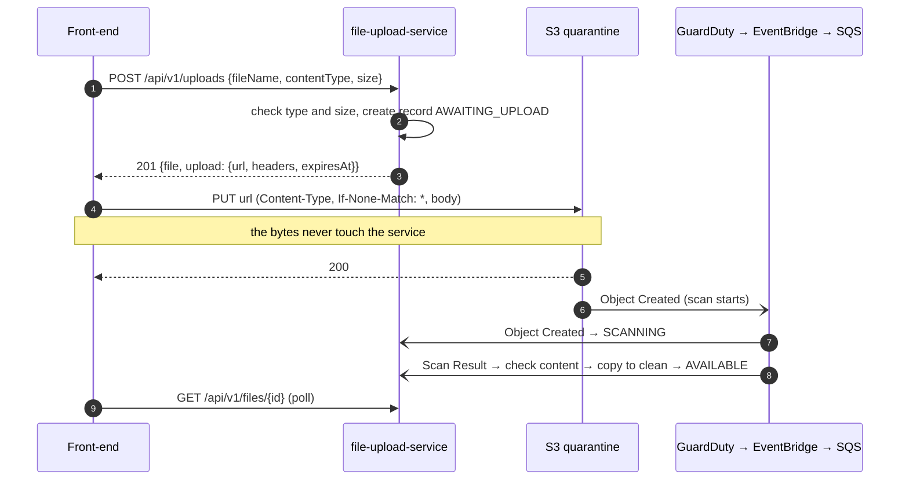
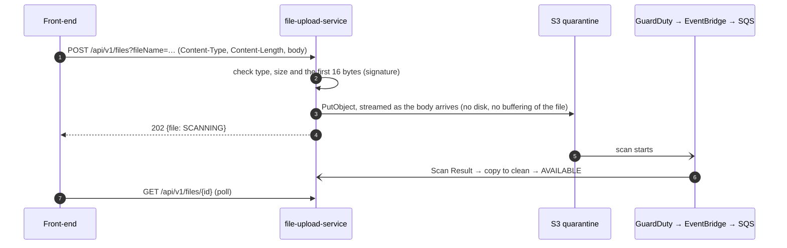

# Upload styles: presigned URL or stream through the service

The service offers both ways for a front-end to send a file. They differ only in how the bytes
reach the quarantine bucket. From there the flow is the same: GuardDuty scans the object, the
service checks the content, and a clean file is copied to the clean bucket. The same status API
reports progress for both. This page compares them, so the team can choose one or keep both.

## How each works

### Presigned URL



The URL is signed for the content type, the exact length and `If-None-Match: *`. S3 refuses
(403) a PUT with another type or length, and refuses a second PUT (412), so the file scanned is
the file that was declared. The URL works for `url-ttl` (15 minutes).

### Stream through the service



The body is the raw file, not `multipart/form-data`. The servlet container would spool multipart
bodies to temporary files, and the service must not need a filesystem.

## Side by side

| | Presigned URL | Stream through the service |
|---|---|---|
| **Bytes through the service** | None: it only signs a URL | All of them |
| **Service cost per upload** | One small request: a DynamoDB write and a signature (milliseconds of CPU) | Proportional to file size: network in and out, a thread for the whole upload, about 128 KB of SDK buffer |
| **Scaling** | Bounded by S3, which scales by itself | Bounded by pods: `max-concurrent-streams` (64) per instance, then 503 with `Retry-After` |
| **Calls from the front-end** | Two: ask for the URL, then PUT to S3 | One |
| **Wrong content (a `.exe` renamed `.png`)** | Accepted by S3; found after the scan, then `REJECTED` (`CONTENT_MISMATCH`) and left in quarantine | Refused at once with 415, before anything is stored |
| **Wrong size or type on upload** | S3 returns 403 `SignatureDoesNotMatch` (XML, little detail for the user) | RFC 9457 problem with a `reason` and a message (`TOO_LARGE`, `CONTENT_MISMATCH`, ...) |
| **Network path for the browser** | Must reach `*.s3.<region>.amazonaws.com`: corporate proxies or firewalls may block it | Only the API's host name |
| **Bucket exposure** | Bucket needs CORS for the front-ends' origins; the URL is a bearer token until it expires | Bucket fully private; only the service's role writes to it |
| **Authorisation** | Checked once, when the URL is issued; anyone holding the URL can upload that one file until it expires | Every byte arrives through the authenticated API |
| **Load balancer and ingress** | Not involved in the upload | Carries every byte: ALB data-processing charges; ingress body-size limits (NGINX defaults to 1 MB) must allow `max-size` |
| **Cost (AWS)** | An S3 PUT request | The same PUT, plus ALB processed bytes, cross-AZ traffic, and pod CPU and network |
| **Large files** | Up to 5 GB in one PUT; presigned multipart (not built) for more, with resumable parts | One PUT up to 5 GB, limited in practice by `stream-timeout` and the client's connection; no resume |
| **Retries after a failure** | Re-PUT to the same URL while it's valid (if nothing landed); otherwise ask for a new URL | Upload again from the start |
| **Abandoned uploads** | The record stays `AWAITING_UPLOAD` until DynamoDB's TTL removes it (URL lifetime + 1 h) | Not possible: the record is created as the bytes arrive |
| **"Picked up for scanning" time** | S3's own time from the Object Created event | The service's clock when its PUT completed |
| **Progress bar in the browser** | Yes (`XMLHttpRequest.upload.onprogress` against S3) | Yes (the same, against the API) |
| **Upload speed far from the region** | S3 Transfer Acceleration can be turned on | Through the ALB in the service's region |

### Measured locally

On a laptop, against the local emulators (`scripts/dev.sh run`, GuardDuty simulated with a 3 s
scan), not AWS:

| | Presigned (176 B PNG) | Stream (45 B PDF) | Stream (20 MB) |
|---|---|---|---|
| Service call to response | 11–14 ms (`POST /uploads`), then the PUT goes to S3 | | 0.34–0.41 s (`POST /files`, 202) |
| Landed → scan result | 3.2 s (the simulator's 3 s) | 4.0 s | |
| Scan result → available (check, copy, delete) | 0.18 s | 0.06 s | |
| Heap in use after streaming | | | ~50 MB, flat across four 20 MB uploads |

Measure on AWS before deciding on cost or capacity (README "Capacity").

## Front-end code

**Presigned:**

```js
const res = await fetch('/api/v1/uploads', {
  method: 'POST',
  headers: {'Content-Type': 'application/json'},
  body: JSON.stringify({fileName: file.name, contentType: file.type, size: file.size}),
});
if (!res.ok) throw await res.json();            // RFC 9457 problem: detail, reason
const {file: record, upload} = await res.json();
const put = await fetch(upload.url, {method: upload.method, headers: upload.headers, body: file});
if (!put.ok) throw new Error(`S3 refused the upload: ${put.status}`);  // 403 changed headers, 412 twice
// then poll GET /api/v1/files/{record.id} until status is AVAILABLE, INFECTED, REJECTED or NOT_SCANNED
```

**Stream:**

```js
const res = await fetch(`/api/v1/files?fileName=${encodeURIComponent(file.name)}`, {
  method: 'POST',
  headers: {'Content-Type': file.type},            // the browser sets Content-Length from the file
  body: file,
});
if (!res.ok) throw await res.json();            // 411, 413, 415 with a reason, or 503: retry
const record = await res.json();                // 202, status SCANNING
// then poll as above
```

`file.type` comes from the file's extension in the browser. Both styles check the bytes against it
(stream: before storing; presigned: before promoting).

## Choosing

- **Presigned** suits most browser and mobile front-ends: the service stays small whatever the
  file sizes, and S3 does the heavy lifting. Its costs are the extra call, bucket CORS, browsers
  reaching S3 directly, and content errors reported only after the scan.
- **Stream** suits clients that can't reach S3 (locked-down networks, server-to-server callers
  behind an egress allowlist), and cases where immediate, readable validation matters more than
  service capacity. Budget pods and ALB traffic for the bytes, and raise any ingress body limit.
- **Both** is a reasonable end state: presigned by default, stream for the clients that need it.
  They share everything after the upload, so keeping both costs one endpoint and its tests.

Questions for the team:

1. Can every front-end's users reach S3 directly (corporate networks, mobile carriers, CSP
   `connect-src`)?
2. Is "refused after the scan" acceptable feedback for a wrong file type, or must the user see it
   at once?
3. What are the real file sizes and volumes? Above about 100 MB, presigned multipart becomes
   worth building; streaming gets expensive.
4. Will an API gateway or WAF in front of the service inspect or limit request bodies?
